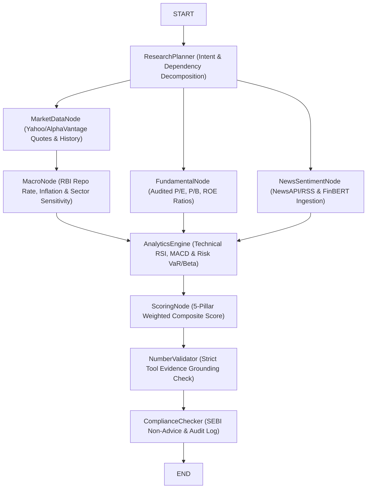

# LangGraph StateGraph Architecture

This Mermaid diagram illustrates the active `@langchain/langgraph` agent workflow powering ARTHA AI research dossier generation.

## State Definition
The StateGraph maintains a strictly typed Annotation state:
- `query`, `intent`, `symbol`, `quote`, `bars`, `fundamentals`, `news`, `sentiment`, `macro`, `technical`, `risk`, `scores`, `evidence`, `draft`, `report`, `warnings`, `trace`.
