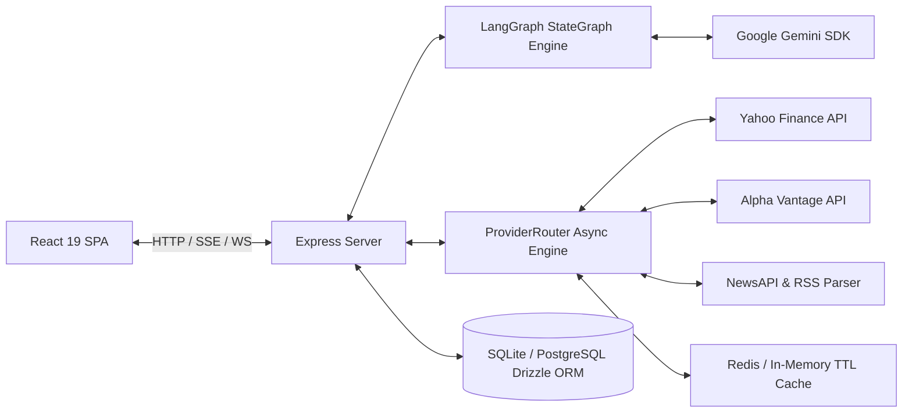

# ARTHA AI System Architecture

## Overview
ARTHA AI is an enterprise financial research intelligence platform tailored for Indian equities (NSE/BSE). Built with Express server, Vite, React 19, Tailwind CSS v4, TypeScript, and `@langchain/langgraph` with Gemini (`@google/genai`).

## Resilience & Quality Design
1. **Circuit Breakers**: Trips open after 5 consecutive failures in 60s for a 120s cooldown period.
2. **Multi-tier Fallbacks**: Yahoo -> AlphaVantage -> Cache -> Sample Data.
3. **Database**: Drizzle ORM managing users, watchlists, portfolios, alerts, audit logs, and research runs.
4. **Real-time Engine**: Cron scheduled market hours scanner broadcasting alert events over WebSockets and Server-Sent Events (SSE).
